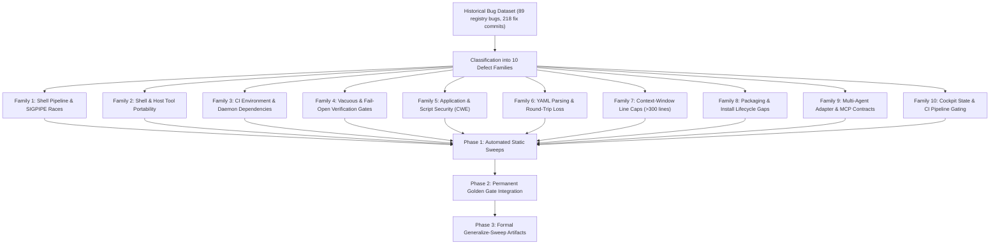

# Defect Generalization & Codebase Sweep Plan

**Status:** Proposed  
**Author:** Antigravity / Daniel VM  
**Date:** 2026-11-03  
**Scope:** Whole repository (`scripts/`, `skills/`, `specs/`, `extensions/`, `.github/workflows/`, `bigpowers-mcp/`)  
**Standard:** Bigpowers Generalize-Fix Doctrine (e80s04 / GH #98)

---

## 1. Executive Summary & Historical Dataset Analysis

Across bigpowers git history and bug tracking artifacts:
- **89 closed bugs** recorded in `specs/bugs/registry.yaml`.
- **95 investigation/fix specs** in `specs/bugs/BUG-*.md`.
- **218 commits** with prefix `fix(...)` across git history.

Every closed bug is an instance of a broader **defect class**. When a bug is fixed locally in one file, sibling instances often remain dormant in other scripts, workflows, or capsules until triggered by an environment change (e.g., CI runner upgrade, macOS vs Linux tool variation, or a large dataset breaching buffer limits).

This plan synthesizes every closed bug into **10 canonical defect families**, establishes exact automated detection mechanisms (grep patterns, AST/JSON linters, self-test harnesses), maps every potential codebase site where they can recur, and defines a phased execution roadmap.



---

## 2. Defect Family 1: Shell Pipeline SIGPIPE / Pipefail Races

### 2.1 Failure Mechanism & Historical Precedent
Under `set -o pipefail` (or `set -euo pipefail`), a pipeline `producer | early_reader` fails with status `141` (SIGPIPE) or Python exit `120` ("Exception ignored on flushing sys.stdout") if:
1. The reader (`grep -q`, `head -n`, `awk '... exit'`, `grep -m`) exits immediately upon finding a match and closes the pipe.
2. The producer is still writing data that exceeds the OS pipe buffer capacity (16 KiB to 64 KiB).
3. Under `set -e`, the non-zero exit terminates the script, or inside `if [ ... ]`, the failure inverts boolean logic.

**Key Closed Bugs:**
- `BUG-2026-11-02-pipefail-pipe-race`: Pipelines with early-exit readers failing at random under pipefail (`land-branch.sh`, `parallel-review-worktrees.sh`, `check-spec-version-gap.sh`, `bp-churn-rank.sh`, `run-smoke.sh`, `validate-doctrine.sh`).
- `BUG-2026-07-06-g06-migrate-version-golden`: G-06 golden test failing due to bash bad substitution + pipefail SIGPIPE in validate checks.
- Commit `4af8526f`: Python `extract-story-verify.py` exit 120 into `grep -q`.

### 2.2 Sibling Scan & Audit Strategy
```bash
# 1. Identify all shell scripts setting pipefail
grep -rlE "set.*pipefail" scripts/ hooks/ bin/

# 2. Find all pipelines feeding early-exit commands
grep -nE '\| *(head|awk .*exit|grep -m|grep -q)' $(grep -rlE "set.*pipefail" scripts/ hooks/ bin/)
```

### 2.3 Verification & Hardening Pattern
- **Pattern A (Capture to variable):** For outputs bounded by memory (`FEATURE_BODIES=$(git log ...); grep -q "pattern" <<< "$FEATURE_BODIES"`).
- **Pattern B (Read to EOF):** Replace `head -N` or early-exit awk with full readers (`awk -v limit=N 'NR <= limit {print}'` or `sed -n '1,Np'`).
- **Pattern C (Regression Suite):** Run `scripts/test-pipefail-pipe-race.sh` which exercises buffer-flooding pipelines with large inputs (300,000+ items).

---

## 3. Defect Family 2: Shell & Host Tool Portability (macOS Bash 3.2 vs Linux GNU vs BSD)

### 3.1 Failure Mechanism & Historical Precedent
Solo developers and CI runners operate on mixed operating systems (macOS Darwin with BSD utilities and Bash 3.2 vs Ubuntu Linux with GNU coreutils and Bash 5). Code passing locally on macOS can fail on Linux CI, and vice versa.

**Key Closed Bugs:**
- `BUG-2026-07-02T103911`: `npm install` failing on macOS because `/bin/bash` is Bash 3.2, which lacks `declare -A` and `mapfile`/`readarray`.
- `BUG-2026-08-05-cycle-time-toolchain`: `record-cycle-time.sh` append failing on macOS because BSD `awk` ignores `-F '\x1f'`.
- `CONVENTIONS.md §318`: `grep -E '\d'` failure: PCRE `\d` is not supported by GNU grep on Linux (treated as literal 'd', matching nothing), but accepted by BSD grep on macOS.
- `run-story-verify.sh`: GNU `timeout` missing on macOS; perl alarm fallback needed.

### 3.2 Sibling Scan & Audit Strategy
```bash
# 1. Bash 4+ constructs (declare -A, mapfile, readarray, &>) across ALL shell scripts
for script in $(find scripts hooks bin -name "*.sh"); do
  grep -vE '^[[:space:]]*#' "$script" | grep -nE '(^|[;&|[:space:]])(mapfile|readarray)[[:space:]]|declare[[:space:]]+-A' && echo "VIOLATION in $script"
done

# 2. PCRE \d or \D in grep -E
grep -rnE "grep\s+-E\s+['\"][^'\"]*\\\\[dD]" scripts/ skills/ tests/ specs/

# 3. Non-portable sed -i usage (BSD requires -i '', GNU accepts -i)
grep -rnE 'sed\s+-i[[:space:]]+[^-]' scripts/ hooks/

# 4. GNU-only coreutils invocations (timeout, xargs -r) without fallback
grep -rnE '\btimeout\b|\bxargs\s+-r\b' scripts/ hooks/
```

### 3.3 Verification & Hardening Pattern
- Enforce CI assertion `Assert runner is bash 3.2 compatible` across **all** repository shell scripts, not just a subset of 3 scripts in `test-build-release.yml`.
- Standardize on `sed` portable pattern: write to a temp file and `mv`, or use perl/python for in-place text replacement.
- Replace all `\d` in regexes with `[0-9]`.

---

## 4. Defect Family 3: Test Isolation, Live Daemon Dependencies & CI Environment Assumptions

### 4.1 Failure Mechanism & Historical Precedent
Stories or verification scripts assuming an ambient environment, persistent background daemon, pre-installed tool, or pre-built dependencies.

**Key Closed Bugs:**
- `BUG-2026-11-03-story-verify-ab-sandbox-daemon-required`: Story `e58s07` chained `bash scripts/ab-sandbox.sh status` directly into `verify:`, requiring active background Docker containers and networks on fresh CI runners.
- `BUG-2026-09-05-golden-gate-missing-node-deps`: Golden gate omp-extension failing in CI because `npm ci` had not been run in that job.
- `BUG-2026-09-13-docs-base-path-gate-ci`: Golden gate `docs-base-path` failing in CI because `website/node_modules` was missing.
- `BUG-2026-07-04-python-interpreter-fragility` & `BUG-2026-07-18-setup-pyyaml-missing`: Scripts calling bare `python3` with no interpreter resolution hitting an environment lacking PyYAML.
- `1070ce31`: Node 24 module resolution treating bare test directories (`node --test test/`) as a module path, failing unless globbed (`test/*.test.js`).

### 4.2 Sibling Scan & Audit Strategy
```bash
# 1. Audit story verify directives for daemon checks or network status commands
python3 scripts/lib/extract-story-verify.py . | grep -E 'status|daemon|docker|service|curl.*localhost'

# 2. Check for bare python3 invocations in scripts without sourcing python-env.sh
grep -rn "python3 " scripts/ | grep -v "python-env.sh" | grep -v "PYTHON"

# 3. Check for bare directory paths in node --test
grep -rnE 'node\s+--test\s+test/?\s*$' specs/ scripts/ package.json

# 4. Check CI job dependency prerequisites
# Audit test-build-release.yml ensuring each job runs necessary setup steps before gates
```

### 4.3 Verification & Hardening Pattern
- Story-level `verify:` commands must be hermetic and headless. Live daemon checks belong to operator preflight / handoff scripts (`HANDOFF-*.md`), not gating verify commands.
- All Python invocations in shell scripts must resolve through `source "$REPO_ROOT/scripts/lib/python-env.sh"; resolve_python`.
- All `node --test` directives must specify explicit file patterns (e.g. `test/*.test.js`).

---

## 5. Defect Family 4: Vacuous, Tautological & Fail-Open Verification Gates

### 5.1 Failure Mechanism & Historical Precedent
A verification command that cannot exit non-zero provides false confidence, passing even when the underlying software is completely broken.

**Key Closed Bugs:**
- `BUG-2026-07-25-fail-open-skill-verify`: 67% of skill verify directives were fail-open (e.g. `test -f file || echo OK`, trailing `|| true`, `exit 0`).
- `BUG-2026-07-04-tautological-verify`: File-existence checks (`test -f ...`) passing vacuously on empty or unmodified boilerplate files without asserting behavioral correctness.
- `BUG-2026-07-26-story-verify-never-executed`: Story-level `verify:` directives in `epic.yaml` were defined but never wired into any test harness or CI pipeline.
- `BUG-2026-07-03-trace-engine-vacuous-gate`: Lossy YAML parsing collecting 1 of 240 stories, allowing `--strict` to pass on an empty set.
- `de9a38eb`: Orphaned test scripts in `scripts/` not wired into the golden suite runner.

### 5.2 Sibling Scan & Audit Strategy
```bash
# 1. Run fail-open detector across all skills
for s in skills/*/SKILL.md; do
  cmd=$(grep -A 1 "^→ verify:" "$s" | tail -1 | tr -d '`')
  bash -c "source scripts/lib/fail-open-detect.sh; is_fail_open_directive \"$cmd\"" && echo "FAIL-OPEN: $s -> $cmd"
done

# 2. Run story-verify self-test to prove anti-vacuity
bash scripts/run-story-verify.sh --self-test

# 3. Run G-13 orphaned script detector
bash scripts/golden-g13-script-orphans.sh

# 4. Scan for vacuous file-only checks in done stories
python3 scripts/lib/extract-story-verify.py . | grep -E 'test -[fd] [^&|]+$'
```

### 5.3 Verification & Hardening Pattern
- Every gate must have a negative-path self-test proving it exits non-zero on a flawed fixture (`--self-test` flag).
- File-existence checks must be combined with content/contract assertions (e.g. `test -f X && grep -q 'expected_token' X && bash -n X`).
- The G-13 orphan script check must run in CI to prevent unwired test scripts.

---

## 6. Defect Family 5: Application & Script Security (CWE Defect Classes)

### 6.1 Failure Mechanism & Historical Precedent
Coding agents or automation introducing security vulnerabilities into tool scripts, dashboards, and integrations.

**Key Closed Bugs:**
- `BUG-2026-10-29-mcp-secret-diffs` (CWE-200: Information Exposure): MCP diff block returned raw file contents including `.env`, private keys, and credential stores.
- `BUG-2026-10-29-dashboard-html-escaping` (CWE-79: Cross-Site Scripting): Project metadata and story titles interpolated directly into HTML strings without escaping.
- `BUG-2026-10-29-dashboard-loopback` (CWE-1327: Binding to Insecure Network Interface): Dashboard server bound to `0.0.0.0` instead of `127.0.0.1`.
- `BUG-2026-10-29-agents-export-quoting` (CWE-78: OS Command Injection): Commands in `AGENTS.md` exported into Bash scripts without shell escaping.
- `BUG-2026-10-29-migration-metadata` (CWE-94: Code Injection): Version metadata injected directly into executable files.
- `guard-git`: Destructive git operations (`git push --force`, `git reset --hard`) executed by agents.

### 6.2 Sibling Scan & Audit Strategy
```bash
# 1. Network Interface Binding (CWE-1327)
grep -rnE '\.listen\([0-9]+,\s*["'\'']0\.0\.0\.0["'\'']' dashboard/ scripts/
grep -rnE 'listen\(.*host=["'\'']0\.0\.0\.0["'\'']' scripts/

# 2. HTML escaping in UI / Dashboard (CWE-79)
grep -rnE 'innerHTML\s*=' dashboard/ website/
grep -rnE 'res\.(send|write)\(.*<[a-z]+' dashboard/

# 3. Shell export / eval injection (CWE-78)
grep -rnE 'eval\s+["'\''\$]' scripts/ hooks/
grep -rnE 'export\s+[A-Za-z0-9_]+=\$(cat|\()' scripts/

# 4. Secret pattern leak in git / tools (CWE-200)
grep -rnE '(sk-[a-zA-Z0-9]{20,}|ghp_[a-zA-Z0-9]{20,}|AKIA[0-9A-Z]{16})' scripts/ specs/ skills/
```

### 6.3 Verification & Hardening Pattern
- Bind local development servers strictly to `127.0.0.1` (loopback).
- Sanitize and escape all HTML interpolations using text content or dedicated escaping helpers (`escapeHtml`).
- Enforce `guard-git` hooks across Claude, Cursor, and Gemini environments.
- Maintain and expand `security-review` CWE fixture tables.

---

## 7. Defect Family 6: YAML Parsing, Schema Integrity & Round-Trip Loss

### 7.1 Failure Mechanism & Historical Precedent
Specs and cockpits in bigpowers rely heavily on YAML (`specs/state.yaml`, `release-plan.yaml`, `epic.yaml`, `*-tasks.yaml`). Regex or naive line parsing corrupts data; lossy serializers strip comments and restructure YAML.

**Key Closed Bugs:**
- `BUG-2026-07-03-validate-specs-no-real-parser`: Grep-only checks let 40 corrupt YAML files pass every gate.
- `BUG-2026-07-03-yaml-roundtrip-corruption`: Release prepare-hook flattened 40 spec files and stripped structure through lossy round-tripping.
- `BUG-2026-06-18T100000`: Frontmatter quotes broken during automated skill generation.
- `BUG-2026-08-06-pi-drops-skills-frontmatter`: Adding story tags before `---` broke pi YAML frontmatter parsing.
- `f50aa931`: Grep for `spec:` in `tasks.yaml` exiting 1 under `set -e` when missing.

### 7.2 Sibling Scan & Audit Strategy
```bash
# 1. Strict PyYAML load over ALL YAML files in repository
python3 -c "
import yaml, glob, sys
errors = 0
for y in glob.glob('specs/**/*.yaml', recursive=True) + glob.glob('.github/**/*.yml', recursive=True):
    try:
        yaml.safe_load(open(y))
    except Exception as e:
        print(f'YAML ERROR: {y}: {e}')
        errors += 1
sys.exit(1 if errors else 0)
"

# 2. Strict frontmatter parsing over all SKILL.md and BUG-*.md files
python3 -c "
import glob, sys
errors = 0
for md in glob.glob('skills/*/SKILL.md') + glob.glob('specs/bugs/BUG-*.md'):
    lines = open(md).read().splitlines()
    if not lines or lines[0].strip() != '---':
        print(f'FRONTMATTER ERROR (no leading ---): {md}')
        errors += 1
sys.exit(1 if errors else 0)
"

# 3. Check for hand-rolled grep YAML parsers in scripts
grep -rnE 'grep\s+["'\''\^][a-zA-Z0-9_-]+:' scripts/
```

### 7.3 Verification & Hardening Pattern
- Use `scripts/yaml-tools.py` or PyYAML for all modifications; never mutate complex YAML files via raw regex/sed.
- Ensure `validate-specs-yaml.sh` validates schemas with real parsers, not grep.

---

## 8. Defect Family 7: Context-Window & File Size Discipline (>300 lines limit)

### 8.1 Failure Mechanism & Historical Precedent
Files exceeding 300 lines breach the LLM context-window budget, causing instruction dilution, hallucinated edits, and high latency.

**Key Closed Bugs:**
- `BUG-2026-06-27T000000`: 8 `SKILL.md` files exceeded line cap, blocking CI on `check-skill-size.sh`.
- `BUG-2026-07-04-filesize-gate-python-blindspot`: Linter only scanned shell scripts, allowing large Python trace-engine files to breach limits invisibly.
- `BUG-2026-07-06-*-oversized`: `run-verification-gates.sh`, `validate-okf.sh`, and `run-golden-suite.sh` exceeded 300 lines.
- `BUG-2026-10-30-compliance-akita-masked`: akita.feature at PASS 17 / FAIL 2 on main due to duplicate helpers and files over 300 lines, masked by the 94% compliance gate.

### 8.2 Sibling Scan & Audit Strategy
```bash
# 1. Run standard skill size check
bash scripts/check-skill-size.sh

# 2. Universal 300-line audit across all scripts, skills, and extensions
find scripts/ skills/ extensions/ bigpowers-mcp/src/ -type f \( -name "*.sh" -o -name "*.py" -o -name "*.ts" -o -name "SKILL.md" \) \
  -exec wc -l {} + | awk '$1 > 300 && $2 != "total" {print $1, $2}'
```

### 8.3 Verification & Hardening Pattern
- Move extensive reference tables and detailed procedural guides into `REFERENCE.md`.
- Extract script helpers into modular single-responsibility libraries in `scripts/lib/`.
- Enforce the G-15 compliance and akita feature gates at 0 failures.

---

## 9. Defect Family 8: Packaging, Distribution & Installation Gaps

### 9.1 Failure Mechanism & Historical Precedent
A project that works in its own source git tree can fail completely when installed via global `npm install -g bigpowers` or in a consumer repo.

**Key Closed Bugs:**
- `BUG-2026-06-24T045323`: `npm install` postinstall failed because `docs/` was excluded from tarball.
- `BUG-2026-08-07-gemini-hooks-missing-npm-package`: `.gemini` and `.cursor` excluded from npm package, breaking Gemini/Cursor global targets.
- `BUG-2026-08-07-interactive-uninstall-silent-noop`: Interactive uninstall reported success while leaving symlinks dangling.
- `BUG-2026-07-26-null-skill-adapters-install-nothing`: `skill: null` in `targets.yaml` silently prevented adapter dispatch.
- `093fef72`: `resolve_repo_root` failing in consumer repos that do not contain a `skills/` directory.
- `c47e3c54`: Installation failing on Windows due to symlink privilege restrictions.
- `26df32bc`: Wire-ci CI templates missing from npm package tarball.

### 9.2 Sibling Scan & Audit Strategy
```bash
# 1. Verify tarball contents contain all necessary assets
npm pack --dry-run 2>&1 | grep -E '(\.gemini|\.cursor|templates|docs|scripts)'

# 2. Run install verification suites
bash scripts/verify-install.sh
bash scripts/test-install-hub.sh

# 3. Test resolve_repo_root in external directories
bash scripts/test-resolve-repo-root.sh
```

### 9.3 Verification & Hardening Pattern
- Validate `package.json` `"files"` list against all install target assets defined in `scripts/targets.yaml`.
- Run `verify-install.sh` in CI across clean environments.

---

## 10. Defect Family 9: Multi-Agent Adapter & MCP Integration Contracts

### 10.1 Failure Mechanism & Historical Precedent
Adapters supporting Claude, Gemini, Pi, OpenCode, Codex, and MCP clients have subtle integration seams where missing environment variables or protocol deviations cause crashes.

**Key Closed Bugs:**
- `BUG-2026-09-09-pi-duplicate-slash-commands`: Pi registering duplicate slash commands from both prompt templates and extension hooks.
- `BUG-2026-09-10-pi-mcp-omp-startup` & `BUG-2026-10-30-mcp-unset-plugin-root`: `bigpowers-mcp` crashing when host does not export `OMP_PLUGIN_ROOT`.
- `2e07b81e`: MCP stdio transport failing when not strictly conforming to newline-delimited JSON.
- `a4875651`: Unhandled exceptions in `omp-hooks` crashing host editor during startup.

### 10.2 Sibling Scan & Audit Strategy
```bash
# 1. Check for un-defaulted environment variable expansions in extensions and MCP
grep -rnE '\$\{?[A-Z0-9_]+\}?' extensions/ .mcp.json bigpowers-mcp/ | grep -v ":-"

# 2. Run extension validation
bash scripts/validate-omp-extension.sh
bash scripts/validate-mcp-package.sh
```

### 10.3 Verification & Hardening Pattern
- Always supply safe fallback defaults: `${OMP_PLUGIN_ROOT:-.}`.
- Wrap host extension hooks in top-level try/catch guards with early bail-out when not in a valid git repository (`inGitRepo`).

---

## 11. Defect Family 10: State Synchronization, Planning Cockpit Drift & CI Release Gating

### 11.1 Failure Mechanism & Historical Precedent
Multiple files representing planning and execution state drifting out of sync, or release jobs executing before quality gates finish.

**Key Closed Bugs:**
- `BUG-001`: Epic status in `epic.yaml` drifting from `execution-status.yaml`.
- `BUG-2026-07-03-version-mirror-drift`: Version mirrors in `state.yaml` and `release-plan.yaml` drifting from `package.json`.
- `BUG-2026-07-26-planning-sot-drift`: `sync-status-from-epics.sh` seeding but failing to reconcile story statuses.
- `BUG-2026-10-25-release-not-gated` & `BUG-2026-10-25-pages-not-gated`: Separate workflow files allowing npm publish or Pages deploy to execute while gate jobs were red or still running.

### 11.2 Sibling Scan & Audit Strategy
```bash
# 1. Check spec consistency and drift
bash scripts/check-spec-drift.sh
bash scripts/check-spec-version-gap.sh
bash scripts/lib/plan-consistency-check.sh

# 2. Check CI pipeline contract (all gates must precede release)
bash scripts/test-ci-pipeline-contract.sh
```

### 11.3 Verification & Hardening Pattern
- Maintain single unified CI pipeline `test-build-release.yml` with explicit `needs: [sync, verification-gates, skill-verify, story-verify]` gating `release` and `pages-build`.
- Run `plan-consistency-check.sh` as part of preflight.

---

## 12. Phased Implementation Roadmap & Sweep Matrix

| Phase | Action Item | Target Defect Families | Artifact Output |
|:---|:---|:---|:---|
| **Phase 1: Automated Static Sweeps** | Execute unified static scan script checking regex portability, unquoted variables, pipefail races, and missing defaults across all repo files. | Families 1, 2, 5, 6, 7, 9 | `specs/verifications/generalize-sweep-audit-report.json` |
| **Phase 2: Gate Hardening** | Expand `test-build-release.yml` bash 3.2 compatibility step to cover all `.sh` scripts; wire missing negative self-tests into golden gates. | Families 2, 4, 10 | Updates to `golden-suite-gates.sh` & workflows |
| **Phase 3: Formal Generalize-Sweep Artifacts** | Generate formal `generalize-sweep-*.json` records for each audited defect class per e80s04 doctrine. | Families 1–10 | `specs/verifications/generalize-sweep-*.json` |

---

## 13. Unified Sweep Script (`scripts/audit-defect-classes.sh`)

To operationalize this plan, create a single executable audit script that performs the checks systematically:

```bash
#!/usr/bin/env bash
# scripts/audit-defect-classes.sh — Comprehensive sweep across all 10 defect families
set -euo pipefail
REPO_ROOT="$(cd "$(dirname "$0")/.." && pwd)"
cd "$REPO_ROOT"

echo "=== Sweeping for Sibling Defect Classes ==="
ERRORS=0

check() {
  local name="$1"; shift
  echo -n "Checking $name... "
  if "$@"; then
    echo "OK"
  else
    echo "VIOLATIONS FOUND"
    ERRORS=$((ERRORS + 1))
  fi
}

# 1. Pipefail early-exit checks
check "Pipefail early-exit readers" bash -c '
  for f in $(grep -rlE "set.*pipefail" scripts/ hooks/ bin/ 2>/dev/null); do
    if grep -nE "\| *(head|awk .*exit|grep -m|grep -q)" "$f" | grep -vE "^[[:space:]]*#"; then
      echo "  In $f"
    fi
  done
'

# 2. Bash 3.2 compatibility
check "Bash 3.2 portability" bash -c '
  for s in $(find scripts hooks bin -name "*.sh" 2>/dev/null); do
    grep -vE "^[[:space:]]*#" "$s" | grep -nE "(^|[;&|[:space:]])(mapfile|readarray)[[:space:]]|declare[[:space:]]+-A" && exit 1
  done || true
'

# 3. YAML validity
check "Strict PyYAML validation" python3 -c '
  import yaml, glob
  for y in glob.glob("specs/**/*.yaml", recursive=True):
    yaml.safe_load(open(y))
'

# 4. 300-line context window limit
check "300-line file limit" bash scripts/check-skill-size.sh

echo "Sweep complete. Result: $ERRORS defect families with active findings."
exit "$ERRORS"
```
